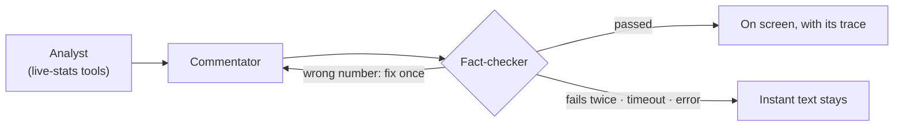

# SecondTouch

**Live football match intelligence, explained by a team of AI agents.**

SecondTouch watches a live (synthetic) football match, turns every action into statistics, picks out the moments that matter and explains *why* they matter: as live commentary, the story behind each key moment, a recap every 15 minutes and a full-time report that tells the story of the match. Fans choose how they watch (analyst, casual fan or following one player), their club and their language (English, Spanish or Japanese).

**Demo video:** _add your YouTube link here_

  

---

## Try it in 3 minutes

You need **Python 3.11+**. No account or key is needed to run it.

```bash
git clone https://github.com/Shinkenji21/SecondTouch.git
cd SecondTouch
python -m venv .venv
.venv\Scripts\activate            # macOS/Linux: source .venv/bin/activate
pip install -r requirements.txt
cd backend
python app.py
```

Open **http://127.0.0.1:8000** and press **START MATCH**.

Or with Docker: `docker build -t secondtouch .` then `docker run -p 8000:8000 secondtouch`.

> **Without an Azure OpenAI key**, everything works (pitch, stats, stories, recaps, reports, three languages) using the instant template engine. The **AI agents** need a key: see [Turn on the AI agents](#turn-on-the-ai-agents) below, or watch them in the demo video.

### What to try

1. Click any player on the pitch to follow them (**Player Cam**), then switch to **Analyst** and **Casual**.
2. Switch the language to **日本語** or **Español**: the whole match so far is rewritten.
3. Pick a club with ★ in the header: Casual commentary now cheers for it.
4. Open **Key Events & Stories** for the story behind each goal, card and save, and a recap every 15 minutes.
5. Let it reach full time: the report opens with **the story of the match**, told through its turning points.
6. With a key: open the **AI Agents** tab and watch each agent's work and the fact-checker's verdict, live.

Press **Guide** in the header for a tour of the screen and a glossary.

---

## How the AI works

A crew of specialised agents built with **Microsoft Agent Framework**, running on **Microsoft Foundry** (gpt-4.1-mini). Each has one job; workflows hand the work from one to the next.

| Agent | Job |
|---|---|
| **Analyst** | Reads an impact moment and fetches the live stats it needs with tools |
| **Commentator** | Writes the moment for three viewers (analyst, casual fan, player cam) in the viewer's language |
| **Storyteller** | Tells the story behind every key event, from its build-up |
| **Recap editor** | Writes a recap every 15 minutes, and a personal catch-up when you come back to the tab |
| **Studio analyst** | Writes the half-time and full-time reports, including the story of the match |
| **Match desk** | Answers fans' questions in *Talk to AI*, using tools |
| **Fact-checker** | Checks every number, score claim and player name against the data. A wrong draft goes back once to be fixed; if it fails again, it never reaches the screen |



**Why it can be trusted live**

- **Fast:** every event appears instantly from the template engine (marked **INSTANT**); the agents' fact-checked version replaces it a few seconds later (marked **AZURE OPENAI ✓ fact-checked**). The live stream never waits for the AI.
- **Reliable:** if the AI is slow or unavailable, the instant text simply stays. Nothing breaks.
- **Transparent:** every AI text shows which agents wrote it and what the fact-checker decided; the **AI Agents** tab shows every run as it happens.
- **Controlled:** the API key stays on the server, never in the browser or the code. Cost limits are built in: AI for the first 2 matches per visitor, at 1x speed, paused while the tab is hidden.
- **Observable:** every agent step can be traced to Azure Application Insights / Foundry tracing with OpenTelemetry.

## Microsoft technologies

| Technology | Used for |
|---|---|
| **Microsoft Agent Framework** | The agents, their tools and the workflows between them ([`backend/agents.py`](backend/agents.py)) |
| **Microsoft Foundry / Azure OpenAI** | The model the agents run on (gpt-4.1-mini) |
| **Azure Monitor / Application Insights** | Optional tracing of every agent run ([`backend/telemetry.py`](backend/telemetry.py)) |
| **Azure Container Apps (ready)** | A Dockerfile packages the app for container deployment |

## Turn on the AI agents

1. In Microsoft Foundry, deploy **gpt-4.1-mini** and copy the key and endpoint.
2. Copy `.env.example` to `.env` and fill in `AZURE_OPENAI_API_KEY`, `AZURE_OPENAI_ENDPOINT` and `AZURE_OPENAI_DEPLOYMENT_NAME`.
3. Restart `python app.py` (with Docker: `docker run --env-file .env -p 8000:8000 secondtouch`). The header shows **AI: Azure**.

`.env` is git-ignored; never commit it. Step-by-step setup: [docs/TECHNICAL.md](docs/TECHNICAL.md#microsoft-foundry-setup).

## Project layout

```
backend/   Python (FastAPI): match simulator, statistics, agents, templates, WebSocket server
frontend/  The web page: pitch, panels, charts (plain JavaScript, no build step)
data/      The fictional clubs and players, and a sample synthetic dataset
tests/     90 automated tests, including a full match replayed through the frontend
docs/      Technical details
```

Run the tests with `python -m pytest` from the project folder.

## Data

All match data is **synthetic**: no real matches, footage, players or licensed feeds. The clubs (Brackenford Athletic and Kestermouth Harbour), players, referee and stadium are fictional, from [`data/reference/`](data/reference/). A generator for bulk synthetic datasets is included (`backend/export_dataset.py`).

## More detail

[docs/TECHNICAL.md](docs/TECHNICAL.md) covers how SecondTouch meets each part of the brief, every panel on screen, the architecture and data contract, how each metric is calculated, the overlay cue feed, and known limitations.
