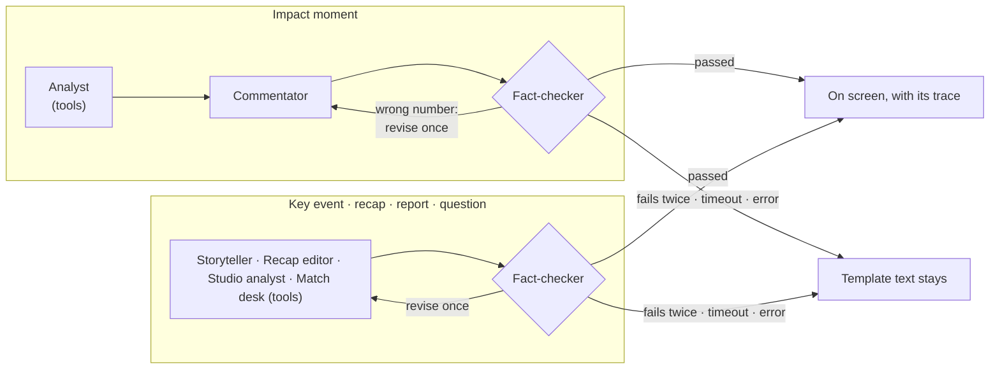

# SecondTouch: technical details

The full reference behind the [README](../README.md): how it meets the brief, the screen, architecture, data contract, metrics, the agent desk and setup.

SecondTouch streams a synthetic football match, turns every action into tactical statistics, flags the moments that matter and explains *why* they matter. The same intelligence reaches a data-hungry analyst, a casual fan and a fan following one player, in English, Spanish or Japanese, and every graphic it shows is also emitted as a timed, machine-readable overlay cue. Impact moments, key-event stories, match reports and viewers' questions are handled by a crew of AI agents built with Microsoft Agent Framework on Microsoft Foundry: an analyst that reads the live stats through tools, writers for commentary, stories and reports, and a fact-checker that rejects any number not in the data. The local template engine renders everything instantly and takes over whenever the agents are unavailable, and the screen always says which one wrote the text.

All match data is generated. No licensed feeds, tracking data or video are used. The two clubs, Brackenford Athletic (home, "The Ferrymen") and Kestermouth Harbour (away, "The Lamplighters"), their players, managers, officials, stadium and league are fictional; they come from the reference dataset in [`data/reference/`](../data/reference/).

## Run it

Requires Python 3.11 or newer.

```bash
python -m venv .venv
.venv\Scripts\activate          # macOS/Linux: source .venv/bin/activate
python -m pip install -r requirements.txt
cd backend
python app.py
```

Open http://127.0.0.1:8000 (not the HTML file directly) and press **START MATCH**. The header badge turns green and shows the event-to-render latency; an event arrives every 1.5 s at 1x.

To turn on the AI agents, copy `.env.example` to `.env` and fill in the three `AZURE_OPENAI_*` values from your Microsoft Foundry deployment (see [Microsoft Foundry setup](#microsoft-foundry-setup)). Without them the app runs fully on the local engine and the header shows **AI: local templates**.

Run the tests from the project root with `python -m pytest`. With Node.js installed this also replays a whole match through the frontend and fails on any rendering error (`tests/frontend_smoke.js`).

## How it meets the brief

| Requirement | Where it is |
|---|---|
| Ingest synthetic events: passes, shots, tackles, possession changes, pressure, metadata | `generator.py` streams passes, dribbles, shots and headers, tackles, fouls, yellow and red cards, offsides, the ball going out of play, set pieces (corners, free kicks including direct shots, throw-ins, goal kicks, penalties), crosses, rebounds, shots off the woodwork, own goals, goals ruled out by VAR, injuries, substitutions, added time, half-time and full-time, each with pressure, a `possession_change` flag and all 22 positions; every match carries metadata (competition, venue, referee, weather, lineups, coaches) |
| Interpret into statistics, patterns and context | `analytics.py`: team and player stats, ratings, tactics from positions, momentum, control vs chaos, pressure shifts, tempo |
| Explain why a moment matters | Every impact moment carries a "why it matters" line citing a metric; the [agent desk](#the-agent-desk-microsoft-agent-framework-on-microsoft-foundry) (Analyst with live-stats tools, Commentator, Fact-checker) rewrites it with context and verifies every number |
| Render alongside the match | 2D pitch, broadcast card, badges and toasts, report card, and timed overlay cues for a graphics engine |
| Personalize | Analyst, Casual Fan and Player Cam modes with different panels; favourite club; favourite player; one pinned metric; three languages |
| Player identification with speed and distance thresholds | Name tags on the players involved; a speed badge when a player sprints at 32 km/h or more, a distance badge at 5 km and 10 km covered |
| Pass quality, ball and shot speed | Pass length, difficulty and accuracy; ball speed on every pass and shot |
| Narratives, milestones, recaps | Story behind every key event, live milestones, a recap every quarter of an hour, a personal "while you were away" catch-up, the half-time report, and a full-time report that opens with **the story of the match**: the turning points in order (goals that changed the lead, red cards, missed penalties, VAR, momentum swings) |
| Explainability: control vs chaos, pressure changes, rhythm | Game-flow state, pressure-shift alerts and tempo, on the pitch and in the analysis tab |
| Synthetic dataset | `export_dataset.py` writes any number of matches as JSONL/CSV; a 3-match sample is in `data/sample/` |
| Multi-language storytelling | English, Spanish and Japanese: commentary, stories, recaps and reports, the pitch graphics, the event log and the interface labels. Switching rewrites the whole match so far, not only what comes next |
| Auto-eventing from video | Not built: there is no video in a synthetic-only project. The pipeline is designed so a video detector can replace the simulator without touching anything downstream; [how it would plug in](#auto-eventing-from-video-how-it-would-plug-in). |

## What you see

| Area | What it shows |
|---|---|
| **Pitch** | All 22 players moving continuously: teams shift with the ball, defenders press the carrier, attackers hold the offside line, runners sprint onto through balls, substitutes jog on. Teams change ends at half-time. Pass lines are coloured by difficulty, dribbles are dotted, shots carry an xG bubble. Speed and distance badges, milestone toasts and the half-time / full-time report appear over the pitch. Click any player to follow them. |
| **Replay bar** | Step back/forward, pause/play, a scrubber with goal and card markers, speed (1x/4x/10x) and **GO LIVE · +N**. Pausing during live play keeps the match running (time-shift). Clicking a goal marker replays its build-up. Keys: Space, ←, →, L, Esc. |
| **Live AI card** | The current moment in the chosen persona and language, its source (`INSTANT`, the templates that keep pace with live play, or `AZURE OPENAI`, the agents), an **IMPACT** badge, and for agent-written text the trail of agents that wrote and checked it. Fresh agent commentary stays on the card for a few seconds so it can be read. |
| **AI Agents tab** | The agent crew and how they hand work to each other, every run as it happens (each agent's step, time, tools called, what the fact-checker found) and running totals. |
| **Mode panel** | *Analyst*: one telemetry card comparing both teams (xG, shots, possession, field tilt, pressure, passing, distance, substitutions), each team's last action, the numbers behind the action on screen, and a badge when a team visibly pushes forward or sits deep late on. *Casual*: the match at a glance in simple charts, a "who's on top" meter and the goals. *Player Cam*: the followed player's card with estimated fitness, stats against the team average, and a heat map. |
| **Guide** | Opens on the first visit and from **Guide** in the header: the screen in seven numbered parts, the three viewing modes, things to try and a glossary (xG, xA, impact moment, pressure index, field tilt, PPDA, fitness...). Every sidebar panel has an ⓘ tip on hover. |
| **Header** | Mode, language, favourite club (highlights its moments; Casual commentary cheers for it), pinned metric (xG, possession, shots on target, pass accuracy, pressure, distance or top speed, always visible). Preferences are remembered in this browser. |
| **Live Event Log** | Every event as it happens, with ⇄ for possession changes, a lightning bolt for impact moments, an icon for each kind of action and set piece, card shapes for bookings, the kind of pass (cross, through ball, long ball), which substitutions were forced by an injury, added time and what play restarts with ("→ corner KHB"). |
| **Match Stats** | Head-to-head team comparison (xA, big chances missed, woodwork, field tilt, crosses, long balls, progressive passes, aerial duels, clearances, blocks, corners, free kicks, throw-ins, goal kicks, penalties, offsides, fouls and cards), then a sortable player table including estimated fitness, xA, aerials, clearances, blocks, fouls won, offsides, distance covered and top speed; the captain is marked C. |
| **Tactics** | Line height, width and length in and out of possession, attack channels, directness, press wins and PPDA, a written read, and average positions. |
| **Key Events & Stories** | Goals and own goals, VAR decisions, woodwork, cards, penalties, direct free kicks, injuries, substitutions, big chances, saves, a recap every 15 minutes and the reports, each with the story behind it: build-up, the moment, and context. A filter for your club's moments. |
| **In-Depth Analysis** | xG race, momentum, game flow (control/balanced/chaos band with each team's pressure), shot map, impact moments, reports. |
| **Talk to AI** | Questions about the live match, answered by the Match desk agent, which fetches the numbers it needs with tools and is fact-checked, or by the local engine. |
| **Data & Overlays** | Download the match (events with positions, events CSV, player stats, overlay cues), match metadata, and the live overlay cue feed. |

## Architecture

```
backend/generator.py        Stage 1a  Possession-based 11 v 11 simulation: one event per call plus all 22 positions
backend/analytics.py        Stage 1b  Metrics, impact filter, stats, game flow, milestones, spells, reports
backend/agents.py           Stage 2   The agent desk: Microsoft Agent Framework agents, tools, workflows, fact-checker
backend/agent_reasoner.py   Stage 2   Microsoft Foundry connection, the agents' instructions, the facts they read
backend/persona_router.py   Stage 3   Templates in en/es/ja: personas, alerts, stories, reports
backend/overlays.py                   Timed, machine-readable overlay cues for each event
backend/app.py              Stage 4   FastAPI WebSocket server, one match per connection
backend/models.py                     Pydantic models for viewer settings, model output and events
backend/export_dataset.py             Bulk synthetic dataset export (JSONL/CSV)
frontend/                   Stage 5   Canvas pitch, broadcast cards, mode panels, replay, tabs
tests/                                pytest suite
```

Each event is sent the moment it is generated with template text for every persona, so switching mode is instant. If Microsoft Foundry is configured, the server then hands impact moments, key events, reports and questions to the agent desk in the background; verified text arrives as an upgrade message with its trace and replaces the template text, and every run (including the ones that fell back) is reported as an `agent_run` message. A slow or failed run never delays the stream. At 4x and 10x only the reports go to the agents.

### Data contract

Client to server (send any subset; each change takes effect at once):

```json
{ "type": "config", "mode": "PLAYER_CAM", "team": "Brackenford", "player": "Thornquist", "speed": 1, "lang": "es", "fav_team": "Brackenford" }
{ "type": "ask", "id": 3, "question": "Who is pressing better?" }
```

Server to client:

```jsonc
{ "type": "match_start", "match_id": 1, "metadata": { "competition": "...", "venue": "...", "referee": "...", "weather": "...",
  "lineups": {}, "bench": {}, "coaches": {}, "formations": {}, "kickoff_utc": "...", "synthetic": true } }

{ "type": "event", "match_id": 1, "sent_at": 1760000000000,
  "event": {
    "seq": 42, "minute": 31.6, "clock": "31'", "team": "Brackenford", "player": "Thornquist",
    "event_type": "SHOT", "outcome": "SAVED", "opponent": "Ederson", "receiver": null, "card": null,
    "length_m": 17.4,
    "location": { "start_x": 84.2, "start_y": 41.0, "end_x": 100.0, "end_y": 52.3 },
    "metrics": { "xg": 0.14, "pass_difficulty": null, "pressure": "HIGH", "pressure_index": 72,
                 "nearest_defender_m": 2.6, "sprint_speed_kmh": null, "ball_speed_kmh": 96.2,
                 "forward_gain_m": null, "players_bypassed": null },
    "score": { "home": 1, "away": 0 }, "possession_change": true, "right_team": "Brackenford",
    "is_impact_moment": true, "impact_reasons": ["shot"], "generated_at": 1760000000000 },
  "positions": { "Brackenford": { "Thornquist": [84.2, 41.0] }, "Kestermouth": {} },
  "commentary": { "analyst": "...", "casual": "...", "player_cam": "...", "source": "LOCAL ENGINE", "lang": "en" },
  "alerts": [ { "kind": "speed", "key": "speed", "team": "Brackenford", "player": "Thornquist", "value": 33.1, "text": "Thornquist hits 33.1 km/h!" } ],
  "story": "Build-up: ... Crewdson saved Thornquist's 0.14 xG shot from 17.4m. ...",
  "report": null,
  "overlays": [ { "id": "42-1", "type": "player_tag", "start_ms": 0, "duration_ms": 1500, "at_ms": 1760000000000, "priority": 2 } ],
  "summary": { "xg": [1.21, 0.64], "shots": [9, 5], "on_target": [4, 2], "momentum": 38, "possession": [54, 46],
               "flow": { "state": "CONTROL", "state_team": "Brackenford", "turnover_rate": 12, "press": {}, "tempo": "STEADY" } },
  "stats": { "teams": {}, "players": {}, "tactics": {} } }

{ "type": "commentary", "match_id": 1, "seq": 42, "commentary": {} }       // AI upgrade, or re-render for a new language/focus/club
{ "type": "story", "match_id": 1, "seq": 42, "story": "...", "source": "AZURE OPENAI" }
{ "type": "report", "match_id": 1, "seq": 88, "narrative": "...", "source": "AZURE OPENAI" }
{ "type": "answer", "id": 3, "text": "...", "source": "AZURE OPENAI" }
```

`event_type` is `PASS`, `DRIBBLE`, `SHOT`, `TACKLE`, `SUBSTITUTION`, `INJURY`, `HALF_TIME` or `FULL_TIME`. Outcomes: passes `COMPLETE`/`INTERCEPTED`/`OUT` (out of play)/`OFFSIDE` (`receiver` is the player flagged)/`OWN_GOAL` (`opponent` put it in their own net; the goal counts for `team`), dribbles `SUCCESS`, tackles `WON`/`FOUL` (the actor is the tackler or fouler, `opponent` the player on the ball), shots `GOAL`/`SAVED`/`MISS`/`BLOCKED`/`WOODWORK`/`DISALLOWED` (ruled out by VAR; `var` gives the reason). `clock` shows added time (`45+2'`), `period` is the half, `added_time` announces the minutes added, `tags` describe the action (`cross`, `delivery`, `claimed`, `through_ball`, `long_ball`, `rebound`; `injury` on a substitution forced by an injury), `stance_change` marks a team starting to push forward or sit deep, and `reshuffle` says who covered after a red card. The event message also carries every player's estimated `fitness`, each team's `stance` and `subs_used`. Set pieces are ordinary passes and shots with `set_piece` set (`CORNER`, `FREE_KICK`, `THROW_IN`, `GOAL_KICK`, `PENALTY`), so they count in every statistic; an event after which play stops carries `restart` and `restart_team` (a saved shot parried behind: `restart: "CORNER"`), and shots carry `body_part` (`FOOT` or `HEAD`). Fields that don't apply are `null`, never a made-up default. Coordinates are percentages of the pitch; `right_team` is the team attacking towards x = 100 (Brackenford in the first half, Kestermouth in the second).

### Overlay cues

Every event carries `overlays`: graphics instructions with `start_ms` and `duration_ms` relative to the event, an absolute `at_ms`, a priority, and either a pitch anchor or a screen layout. Types: `player_tag`, `action`, `set_piece`, `speed_badge`, `distance_badge`, `lower_third`, `stat_card`, `banner` (goals, own goals, VAR, cards, penalties, injuries, substitutions, HT, FT), `report_card`. The schema is served at `/api/overlay-schema`, the pitch's own badges are drawn from this feed, and the Data & Overlays tab shows it live.

## How the metrics work

Distances are converted to metres (105 × 68 m) before any maths.

- **Expected goals (xG)**, shots only: a logistic model of distance *d* (m), the angle *θ* the goal mouth subtends (radians) and the pressure index *p*: `xG = 1 / (1 + e^-(-1.2 - 0.09d + 1.5θ - 0.005p))`. An unpressured penalty-spot shot is about 0.23, a 25 m effort about 0.05. The goal is rolled against the xG.
- **Defensive pressure** is measured from the simulated positions: the distance to the nearest opponent. Index = 100 − 11 × metres (0–100). HIGH ≥ 66, MEDIUM ≥ 33, otherwise LOW.
- **Pass difficulty** (5–99): `5 + 1.2 × length + 0.3 × pressure + 18 × forwardness + 3 × max(0, 5 − receiver space)`, where forwardness is the cosine of the pass direction towards goal. Harder passes are more likely to be intercepted.
- **Impact moment**: every shot; a completed line-breaking pass (forward gain ≥ 25 m with difficulty ≥ 70, or 6+ opponents bypassed); a high-pressure turnover; any card.
- **Control vs chaos**: over the last 16 actions, a turnover rate of 38% or more is *chaos*; 20% or less with one team holding 60% of the ball is *control* by that team; otherwise *balanced*.
- **Pressure applied**: the average pressure index a team puts on the opponent's player on the ball over their last 12 actions. A rise of 15 points or more triggers a pressure-shift alert.
- **Tempo**: actions per minute over the last 6 minutes against the match average: 1.2× or more is high, 0.8× or less is slow.
- **Momentum** (−100 to +100): a rolling window of weighted final-third actions, line breaks, shots, goals and ball wins.
- **Distance covered**: movement between position snapshots plus running between them (about 92 m per minute outfield, 40 m for goalkeepers); about 10 km per full match. **Top speed**: the fastest dribble or run onto a through ball.
- **Player rating**: starts at 6.0 and moves with goals, assists, key passes, passing, dribbles, tackles, interceptions, shots on target, xG, saves, fouls and cards, clamped to 3–10.
- **Milestones**: first goal, brace, hat-trick, 25/50 touches, 20/40 completed passes, team pass totals, 3/5 tackles won, 3/5 saves, the longest possession spell, the fastest sprint of the match.

A simulated match averages about 170 events, 15 shots, 1.9 goals and 78% pass accuracy.

## Synthetic dataset

```bash
cd backend
python export_dataset.py --matches 50 --seed 1 --out ../data/synthetic
```

Writes `events.jsonl` (with all 22 positions per event), `events.csv`, `players.csv`, `matches.csv` and a field guide. A 3-match sample is in [`data/sample/`](../data/sample/). The Data & Overlays tab also downloads the match you are watching.

## Auto-eventing from video: how it would plug in

SecondTouch does not watch video: there is no real footage in a synthetic-only project. What it does have is a clean seam where a video system would connect. Everything after event detection (statistics, impact moments, commentary, AI, stories, overlays, replay, the dataset) only ever sees events in the [data contract](#data-contract) above, so a detector that produces those events can replace the simulator without changing the rest of the system.

```
 match video ──► 1. detect ──► 2. track ──► 3. map to pitch ──► 4. recognise events ──► events + positions ──► SecondTouch
                 players,      identities     camera → 105 x 68 m    pass, shot, tackle,      (this contract)       (unchanged)
                 ball          over time      (homography)           out of play, ...
```

| Stage | What it does | Typical approach | Fills in |
|---|---|---|---|
| 1. Detect | Find the players, referee and ball in every frame | An object detector (YOLO-family) fine-tuned on football footage | Bounding boxes |
| 2. Track | Keep each player's identity across frames and through occlusion; split the two teams | A multi-object tracker (ByteTrack/BoT-SORT), team from kit colour clustering, shirt numbers by OCR where visible | Player ids, `team` |
| 3. Map to the pitch | Turn camera pixels into pitch metres, even as the camera pans and zooms | Pitch-line keypoint detection and a per-frame homography | `positions` for all 22 players, `location`, `length_m` |
| 4. Recognise events | Read the actions from who has the ball and where it goes | Rules on ball-possession changes and ball trajectory, plus an action-spotting model for shots, tackles and set pieces | `event_type`, `outcome`, `receiver`, `opponent`, `set_piece`, `restart` |
| 5. Measure | Derive what the simulator computes today | Speeds and distances from the tracks; the existing formulas for pass difficulty, pressure and xG in `analytics.py` | `metrics`, speed and distance badges |

**Where it connects in the code.** The server asks one object for each next event: `MatchSim` in `generator.py`, through `next_event()`, plus its `positions`, `possession`, `right_team` and `metadata` (and `fitness()`, `stance`, `subs_used` for the extras). A `VideoEventSource` with the same methods, reading the detector's output instead of simulating, is the only new backend piece. The metric formulas in `analytics.py` already take positions and distances as input, so they work unchanged on tracked data.

**What would stay out of reach without more data.** Shirt numbers and identities are unreliable from broadcast angles, players off camera have no position, and a single camera cannot see all 22 players at once; production systems use multiple fixed cameras for this. Live latency also grows with every stage, so the 2-second event-to-render target would need GPU inference.

## The agent desk (Microsoft Agent Framework on Microsoft Foundry)

The AI layer is a broadcast crew of specialised agents built with **Microsoft Agent Framework** and running on a **Microsoft Foundry** deployment (gpt-4.1-mini, Azure OpenAI). Each has one job, they share one live view of the match (the `MatchDesk`), and Agent Framework **workflows** hand the work from one to the next ([`backend/agents.py`](../backend/agents.py)).

| Agent | Role | Tools |
|---|---|---|
| **Analyst** | Reads an impact moment and decides the one thing that matters about it, fetching context as it needs it | `get_team_comparison`, `get_player_stats`, `get_game_flow`, `get_tactics`, `get_recent_events` |
| **Commentator** | Turns the analyst's brief into the three personas (analyst, casual fan, player cam) in the viewer's language, as validated JSON | |
| **Storyteller** | Writes the story behind a key event from its build-up | |
| **Studio analyst** | Writes the half-time report, and the full-time report opening with the story of the match told through its turning points | |
| **Recap editor** | Writes a recap every quarter of an hour and the personal catch-up for a viewer back from another tab | one tool for context |
| **Match desk** | Answers viewers' questions in *Talk to AI*, fetching exactly the numbers it needs | the same five tools |
| **Fact-checker** | A deterministic workflow executor: checks every number, every "who leads" claim and every player name in a draft against the facts and the tool results | |



**Why a team and not one prompt.** Splitting the work keeps each instruction short and each agent good at one thing: the analyst can pull the context a moment needs (a press-win count, a player's numbers) instead of being handed everything; the commentator only has to write; and the fact-checker turns "the model might invent a stat" into a guarantee, because a draft with a number that is not in the data never reaches the screen. Its tests cover exactly the slips a single prompt made before the crew existed: claiming a team led at 0-0, and numbers that matched nothing in the data; such a draft is sent back with the problems listed, and only a corrected version is shown.

**Recovering from failure.** Every run has a 14-second budget and every model call a 6-second timeout. A failed check sends the draft back once with the problems listed; a second failure, a timeout, an unusable reply or a network or content-filter error ends the run, and the instant template text simply stays on screen. The live stream never waits for any of it.

**Transparency.** Every run reports a trace (which agent did what, how long it took, which tools it called, what the checker found). The AI card shows it under the text ("Analyst 2.6s · 1 tool → Commentator 1.7s → Fact-checker passed"); stories, reports and answers carry a "✓ fact-checked" tag; and the **AI Agents** tab shows the crew, every run as it happens and running totals (verified first time, fixed on revision, kept templates, average time, tool calls).

**Tracing.** Agent Framework emits OpenTelemetry spans for every workflow, agent run, model call and tool call, and each pipeline adds one span with its outcome (kind, language, verified or not, revisions, tools, time). Set `APPLICATIONINSIGHTS_CONNECTION_STRING` and they go to **Azure Application Insights** ([`backend/telemetry.py`](../backend/telemetry.py)); connect the same Application Insights resource to the Foundry project and every run appears on its **Tracing** page. Prompts and replies stay out of the traces unless `TRACE_CONTENT=1`.

**Cost guard.** The stream plays match after match while a tab is open, so the agents write for the first `AI_MATCHES_PER_VIEWER` matches of a visit (2 by default) and pause while the tab is hidden. *Talk to AI* always answers. Only impact moments, key events and reports go to the agents, and only at 1x speed (reports at any speed).

## Microsoft Foundry setup

1. In the Azure portal (or at ai.azure.com), create a **Foundry** resource in a region your subscription allows (student subscriptions are limited to a few regions; Japan East works well).
2. In the Foundry portal, open **Models + endpoints** and deploy a fast, non-deprecated model such as **gpt-4.1-mini** with deployment type **Global Standard**. Note the deployment name.
3. From the Foundry home page copy the **API key** and the **Azure OpenAI endpoint** (`https://<resource>.openai.azure.com/`; a `/openai/v1` suffix is accepted and removed).
4. Copy `.env.example` to `.env` and fill in `AZURE_OPENAI_API_KEY`, `AZURE_OPENAI_ENDPOINT` and `AZURE_OPENAI_DEPLOYMENT_NAME`.
5. Restart `python app.py`. The header shows **AI: Azure · your-deployment** and the AI Agents tab says the crew is running on Microsoft Foundry.

| Variable | Purpose |
|---|---|
| `AZURE_OPENAI_API_KEY` | Enables the AI path; blank means local templates |
| `AZURE_OPENAI_ENDPOINT` | Your resource URL, e.g. `https://my-resource.openai.azure.com/` |
| `AZURE_OPENAI_DEPLOYMENT_NAME` | Deployment the agents use, e.g. `gpt-4.1-mini` |
| `AZURE_OPENAI_API_VERSION` | Defaults to `2024-10-21` |
| `AZURE_OPENAI_TIMEOUT_S` | Per-call timeout; defaults to 6 (a whole agent run is capped at 14 s) |
| `AI_MATCHES_PER_VIEWER` | Matches per visit the agents write for; defaults to 2 (*Talk to AI* always uses them) |
| `EVENT_INTERVAL_S` | Seconds between events at 1x, 1–2; defaults to 1.5 |
| `APPLICATIONINSIGHTS_CONNECTION_STRING` | Optional: trace every agent run to Azure Application Insights / Foundry tracing |
| `TRACE_CONTENT` | `1` also records prompts and replies in the traces; off by default |

`.env` is git-ignored and must never be committed.

## Performance

Every event carries `generated_at`; the browser records the time to render it and shows the 95th percentile of the last 100 events in the header badge (amber above 2 s) and logs it to the console. Template text is ready at send time, so this latency does not include the model call; AI upgrades typically arrive about a second later.

## Known limitations

- The match is random but internally consistent; it is a simulation, not a model of real players. Only notable actions are generated (about 170 per match, not every touch), so totals such as passes are lower than in a real match.
- Agent-written text exists in the language it was written in: after switching language, earlier moments show the template text in the new language, and the agents' version comes back when you switch back. The long help notes and the Guide are in English.
- Talk to AI answers from the local engine are in English only and cover common questions (a player, the best player, xG, momentum, game flow, pressing/tactics, the match so far, reports, the score); with Foundry keys set, the Match desk answers in the viewer's language.
- How the match is played comes from the reference data too. Each club's `playing_style` sets its passing (Brackenford keep the ball more with shorter passes, Kestermouth go longer and more direct), how wide it plays and how hard and high it presses. Each player's `stamina` sets how fast they tire; tired players run slower, misplace more passes, lose more duels and commit more fouls, and a player's `preferred_foot` decides whether a winger crosses from their natural side or cuts inside. Managers react to the score: a side behind late on pushes up, presses harder, shoots more and brings on attackers; a side ahead late on drops deeper and brings on defenders. Up to `substitutions_allowed` (5) changes in at most 3 in-game windows, for tired legs, a booked player, tactics or injury (injuries come from fouls and force a change). VAR (`var_in_use`) checks goals and rules a few out. Added time is built from the stoppages in each half. A defender sent off is covered by a midfielder dropping into the back line. The wet, windy conditions make long passes less accurate, the quick pitch speeds the ball up, the home side has a small edge, and the captain is marked.
- Set pieces follow the reference data: penalties go to the best shooter on the pitch, corners to the best passer, direct free kicks to the best mix of shooting and passing, and the tallest, strongest players attack corners. Passing, dribbling, defending, shooting and goalkeeping attributes nudge each action's success, and the referee's yellow-card, red-card and penalty rates set how often fouls are punished (about 13 fouls, 4 yellows, 0.2 reds and 0.35 penalties a match, with 8 corners, 7 crosses, 0.7 shots off the woodwork, 0.1 own goals and about +3 and +5 minutes of added time). Defenders stand 9.15 m from free kicks, form a wall for shots at goal, mark in the box at corners and clear the box for penalties.
- Clubs, squads, formations, managers, officials, venue, weather, head-to-head and storylines are read from `data/reference/match_reference_data.json` (made by `generate_reference_data.py` in the same folder, fixed seed). Each player's top speed in that file caps their sprints and carries. The substitutions the simulation makes are listed in `SUB_PLAN` in `generator.py`; the crests are `frontend/images/brackenford.svg` and `kestermouth.svg`.
